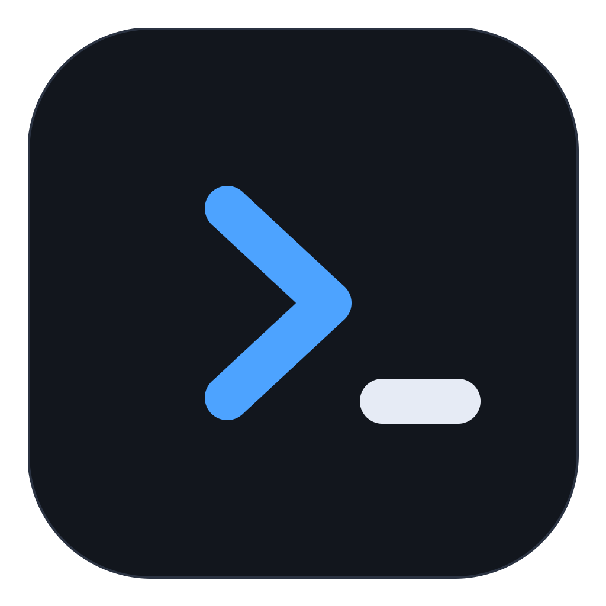
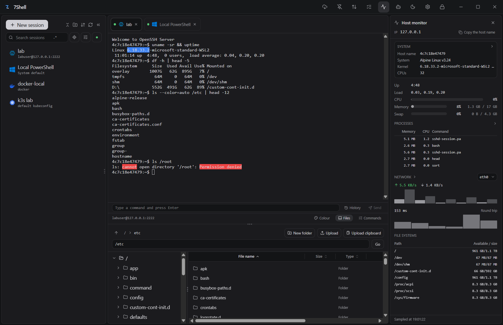
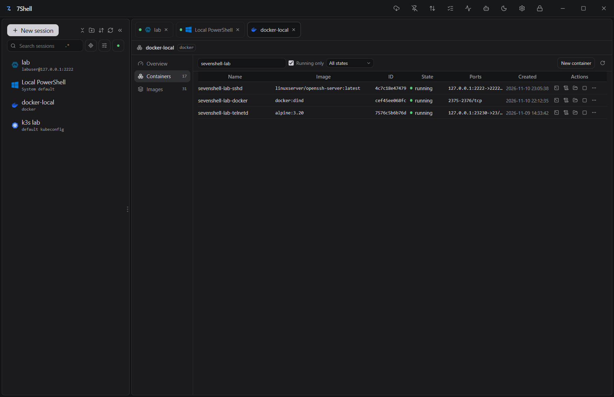
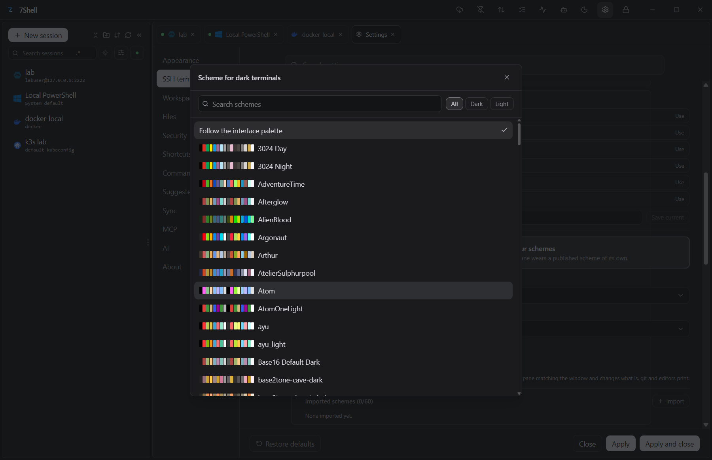
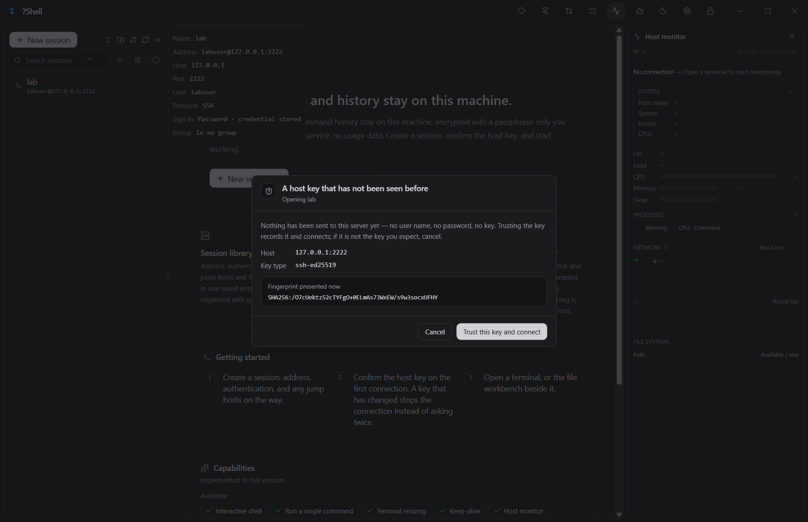

<div align="center">
  
  <h1>7Shell</h1>
  <p>An open-source SSH and operations client for Windows, macOS and Linux<br>SSH, SFTP, Docker, Kubernetes, host monitoring and batch commands</p>
  <p><a href="https://github.com/7wdn/7shell">GitHub</a> &nbsp;|&nbsp; <a href="docs/">Documentation</a> &nbsp;|&nbsp; <a href="https://github.com/7wdn/7shell/releases">Releases</a></p>
</div>

<div align="center">
  English &nbsp;|&nbsp; <a href="README.zh-CN.md">简体中文</a>
  <br><br>
  <a href="https://github.com/7wdn/7shell/releases"></a>
  <a href="https://github.com/7wdn/7shell"></a>
  <a href="LICENSE"></a>
</div>

## Contents

- [Features](#features)
- [Connections](#connections)
- [Screenshots](#screenshots)
- [Install](#install)
- [Getting started](#getting-started)
- [Tech stack](#tech-stack)
- [Build from source](#build-from-source)
- [Project layout](#project-layout)
- [Documentation](#documentation)
- [Security](#security)
- [Contributing](#contributing)
- [License](#license)

## Features

### Terminals

- **Remote terminals** — SSH with a password, a private key, keyboard-interactive authentication or the system key agent; Telnet, raw TCP and serial.
- **Local terminals** — PowerShell, Command Prompt, Git Bash, the Unix login shell and WSL on Windows.
- **Terminal workspace** — tabs, search, links, keep-alive, reconnect and asciicast v2 recording.
- **Appearance** — 190 built-in colour schemes; adjustable font family, size, line height, letter spacing and cursor; keyword highlighting with 22 default rules (ERROR, WARN, IP addresses and others) that can be edited.
- **Jump hosts and forwarding** — routes through other saved sessions, local port forwards (`-L`) and a SOCKS5 proxy (`-D`).

### Files

- **SFTP workbench** — two panes, create, rename, delete, edit text in place, upload and download.
- **Transfers** — queue, pause, resume and outlive the tab; on SSH a whole directory can be sent as one archive.
- **Other file servers** — WebDAV and FTP/FTPS folders in the same workbench; a server without SFTP falls back to SCP.
- **ZMODEM** — `rz` and `sz` inside the terminal, using the system file dialogs.

### Containers and clusters

- **Containers** — Docker, Podman, nerdctl and WSLC: containers, images, logs, stats, an exec terminal, files and image archive import, on this machine or through an SSH session.
- **Kubernetes** — kubeconfig contexts, resource lists and watches, pod logs, exec, pod files, metrics and YAML editing, directly or through an SSH session.

### Operations

- **Host monitor** — load, CPU, memory, swap, disks, processes, network and sockets, sampled over the connection that is already open; nothing to install on the server.
- **Batch execution** — one command to several hosts, a result per host and a risk verdict before it runs.
- **Command library** — saved commands with `#1`–`#5` slots, history and completion, sent to one terminal or all of them.
- **Interface** — system, dark or light theme; English and Simplified Chinese.
- **Sync** — sessions and commands to a WebDAV server, or to a snippet on GitHub, Gitee or GitLab.
- **RDP** — Windows desktops through the system Remote Desktop client.

### Assistant and MCP

- **Assistant** — Anthropic, OpenAI-compatible endpoints and local models.
- **MCP server** — external MCP clients can call the same tools on saved sessions; credentials stay in the application.
- **Approval and audit** — tool calls are checked against the risk rules and written to an audit log, and an approval prompt appears when a call needs one.

## Connections

| Category | Connection | Notes |
| --- | --- | --- |
| Terminal | SSH | Password, private key, keyboard-interactive or the system key agent |
| Terminal | Telnet | RFC 854 subset, with window reporting and the Enter/Backspace a device expects |
| Terminal | Raw TCP | Plain socket, no negotiation |
| Terminal | Serial | Port, baud rate, data bits, parity, stop bits and flow control |
| Terminal | Local shell | PowerShell, Command Prompt, Git Bash, Unix login shell |
| Terminal | WSL | Installed distributions, Windows only |
| Files | SFTP | Browse, edit, upload and download |
| Files | SCP | Fallback when the server has no SFTP subsystem |
| Files | FTP / FTPS | Plain FTP, or TLS before the login |
| Files | WebDAV | HTTP folders in the same workbench |
| Files | ZMODEM | `rz` and `sz` inside a terminal |
| Containers | Docker | Containers, images, logs, stats, exec, files |
| Containers | Podman | Podman engine, same workspace |
| Containers | nerdctl | containerd, with namespace selection |
| Containers | WSLC | Windows containers, Windows only |
| Cluster | Kubernetes | Contexts, resources, logs, exec, files, metrics, YAML |
| Remote desktop | RDP | Windows only, through the system client |

## Screenshots

<p align="center">
  
  
</p>
<p align="center">
  
  
</p>

## Install

Installers are published on [GitHub Releases](https://github.com/7wdn/7shell/releases).

- **Windows** — `.exe` (NSIS) or `.msi`, plus a `-portable.zip` that keeps its vault and settings in a `data` folder beside the executable, and an `-offline-setup.exe` that carries the WebView2 runtime.
- **macOS** — `.dmg` for Apple silicon or Intel.
- **Linux** — `.AppImage`, `.deb` or `.rpm`.

The builds are not code-signed and the macOS app is not notarized. Windows SmartScreen and macOS Gatekeeper will warn about an unsigned build, and macOS may refuse the first launch. Check the SHA-256 in the release notes against the file you downloaded. Winget, Scoop and Homebrew manifests are attached to each release but are not in the package registries yet.

## Getting started

1. Create the vault on first launch. The passphrase is not stored and cannot be recovered.
2. Add a session: address, authentication method and, if needed, jump hosts.
3. Confirm the host key on the first connection. A changed key stops the connection instead of asking again.
4. Open a terminal. The file workbench below it and the host monitor beside it use the same session.

## Tech stack

| Layer | Technology |
| --- | --- |
| Desktop shell | Tauri 2 |
| Core | Rust (russh, portable-pty) |
| Interface | Vue 3, Pinia, Tailwind CSS |
| Terminal | xterm.js |
| Assistant | Anthropic Messages, OpenAI-compatible, local models |

## Build from source

- Rust, pinned by `rust-toolchain.toml`; `rustup` installs it on the first build.
- Node 22.13 or newer, and pnpm 11.
- Windows: the MSVC toolchain and WebView2.
- Linux: the WebKitGTK and GTK development packages.

```bash
git clone https://github.com/7wdn/7shell.git
cd 7shell
pnpm install
pnpm dev:tauri   # the desktop application
pnpm check       # every gate
```

[CONTRIBUTING.md](CONTRIBUTING.md) has the full setup and test commands.

## Project layout

```text
crates/          Rust crates: SSH, SFTP, containers, Kubernetes, policy, AI, MCP
src-tauri/       Tauri host: commands, windows, native dialogs
apps/desktop/    Vue 3 interface
descriptors/     Capability descriptors that generate wire types and manifests
docs/            Documentation and screenshots
```

## Documentation

- [Install](docs/guide/install.md)
- [Getting started](docs/guide/getting-started.md)
- [Security model](docs/security-model.md)
- [Architecture](docs/architecture.md)
- [FAQ](docs/guide/faq.md) and [troubleshooting](docs/guide/troubleshooting.md)

## Security

- Credentials are stored in a local vault encrypted with Argon2id and XChaCha20-Poly1305. The passphrase is never saved.
- A host key is read over a probe that sends nothing, compared with the trusted keys on this device, and only then used for authentication. An unknown key is shown for confirmation; a changed key stops the connection.
- The interface never receives a local path. Files are picked in native dialogs in Rust and passed on as opaque tokens.
- Tool calls from the assistant and from MCP clients go through the risk rules and the audit log, with an approval prompt when a call needs one. Typing in a terminal is not gated.
- The update check is the only request the application makes on its own, and it can be turned off. Sync only connects to the server you configure.

The [security model](docs/security-model.md) lists each invariant and whether a test holds it.

## Contributing

Issues and pull requests are welcome. [CONTRIBUTING.md](CONTRIBUTING.md) covers the toolchain and the gates a change has to pass. Report vulnerabilities through [SECURITY.md](SECURITY.md), not a public issue.

## License

Apache-2.0. See [LICENSE](LICENSE).
