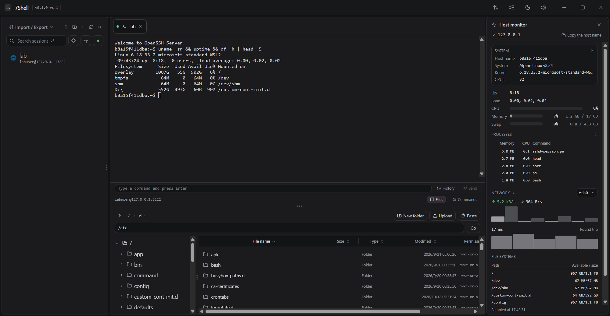

# 7Shell

**An open-source SSH and operations console for Windows, macOS and Linux.**

*Read this in [Chinese](README.zh-CN.md).*



> **Status: first candidate release.** `0.1.0-rc.1` is a prerelease built to be tried, not relied on.
> Nothing here has had a security review. The installers are not code-signed and the macOS build is
> not notarized, so both operating systems will warn before running them. **Do not put production
> credentials into this build.**

## What it is

A desktop client for the machines you administer: save a host once, connect over SSH, work in a
terminal or in the file workbench beside it, watch what the host is doing, and send one command to
several machines at once. Credentials live in an encrypted vault on your machine, and a server's host
key is verified *before* any credential is sent to it.

One Rust binary with a Tauri shell around it. No JRE, no Python, no bundled browser runtime.

## What works today

This is the same list the interface shows on its first screen, and both are generated from the
descriptors the code is built against: a capability is claimed by the change that implements and tests
it, never in advance.

| Area | State |
|---|---|
| Encrypted vault: Argon2id + XChaCha20-Poly1305, atomic writes, one unlock failure for a wrong password and for a changed file | Working, with tests |
| Sessions and groups, saved in the vault; import and export with an optional passphrase | Working |
| Host key verification: trust a new key, stop on a changed one, review and revoke what is trusted | Working, tested against a real sshd |
| Authentication: password, private key (with passphrase), keyboard-interactive, and the system key agent | Working, tested against a real sshd |
| Terminals: several tabs, resize, keep-alive, reconnect, search, links, and a palette per session | Working |
| Jump hosts: a route through other saved sessions, every hop verified as if it were the destination | Working, tested against a real sshd |
| Port forwarding: a local port reaching the far side (`-L`), and a local SOCKS5 port (`-D`) | Working, tested against a real sshd |
| The file workbench: two directories side by side, create, rename, delete, edit text, upload, download | Working, tested against a real sshd |
| Transfers: queued and listed, pausable and resumable, packed as one archive for a whole tree, outliving the tab they started in | Working, tested against a real sshd and a 50,000-file directory |
| Host monitor: load, memory, disks, processes and sockets, sampled over the connection you already have | Working |
| Batch execution: one command, several hosts, a per-host result, and a risk verdict before it runs | Working, tested against a real sshd |
| Command library: saved commands with `#1`–`#5` slots, history, completion, sent to one terminal or all of them | Working |
| Session recording: each session's output as an asciicast v2 file | Working, tested against a real sshd |
| Sync: sessions and commands to a WebDAV server you name, or as a snippet on GitHub, Gitee or GitLab | Working, tested against a real server |
| The update channel: a signed manifest, an install that restarts into the new version, an off switch | Working; see below for what has not been exercised yet |

**Not implemented:** remote forwarding (the third kind — refused rather than half-done), agent
forwarding (implemented, deliberately unclaimed until a real far side has been proved to use it),
Pageant, and reaching a host *through* a SOCKS5 or HTTP proxy. The command line and agent interfaces
and the plugin platform are 1.x work: the architecture keeps room for them, and no code for them
exists yet.

## Installing

Release builds come from [GitHub Releases](https://github.com/7wdn/7shell/releases):

| Platform | Files |
|---|---|
| Windows | `.exe` (NSIS) and `.msi` — per-user install, no administrator needed |
| macOS | `.dmg` for Apple silicon and for Intel |
| Linux | `.AppImage`, `.deb`, `.rpm` |

Because this is a prerelease, expect a warning: Windows SmartScreen and macOS Gatekeeper both object
to software nobody has signed. Linux has no equivalent gate, which is not the same thing as being
verified.

Package manager manifests for Winget, Scoop and Homebrew are attached to each release; they are not
in the registries yet — [packaging/README.md](packaging/README.md) says what each submission takes.

### Building it

Rust (pinned by `rust-toolchain.toml`), Node 22 or newer, pnpm 11, and on Windows the MSVC toolchain
with WebView2 (present on Windows 10 and later). On Linux, the WebKit and GTK development packages,
which the CI workflow lists in full.

```bash
pnpm install
pnpm dev:tauri        # the desktop application
pnpm dev              # the interface alone, in a browser, without a backend
pnpm check            # every gate: descriptors, translations, versions, origin, tests, Rust
pnpm app:e2e          # drive the real window (Windows; the terminal cases need the lab)
```

## Security, plainly

- **Credentials are encrypted at rest.** The vault is a file on your machine, opened with a passphrase
  that is never stored, and no wire type in the application can carry a password or a key.
- **A host key is verified before anything is sent.** An unknown key is a question with the
  fingerprint in it; a key that *changed* stops the connection rather than asking twice.
- **The interface never sees a path.** Files are chosen through native dialogs in Rust and handed to
  the interface as opaque tokens, so a compromised webview cannot read your disk.
- **One request goes out on its own**: the update check, which asks GitHub for a signed manifest and
  sends nothing about you. It has an off switch under Settings → About, and turning it off leaves
  everything else working. Sync is opt-in: it happens only with the server you name.
- **No audit.** The security model is written down in [docs/security-model.md](docs/security-model.md),
  including the parts that are not implemented yet. Until an external audit happens, treat this build
  as software you are trying rather than software you trust.

### The update channel

An installed build asks a fixed URL for a signed manifest, verifies the signature against the public
key compiled into it, and installs what the manifest names — then restarts. The manifest is written by
the release workflow from the files that release built, and the workflow refuses to publish one for an
archive nobody signed ([docs/release-process.md](docs/release-process.md)).

It has **not delivered an update yet**: that needs two releases, and there has been one. Until then,
treat "an update is available" as a feature to try rather than a channel to depend on.

## Working on it

| Command | What it does |
|---|---|
| `pnpm check` | Every gate in one command: descriptors, i18n, versions, provenance, guard tests, formatting, lint, types, unit tests, the docs build, and the Rust gates |
| `pnpm app:e2e` | Drives the real window over the DevTools protocol (Windows) |
| `pnpm screenshots` | Re-takes the pictures in this file and on the docs site, from the real window |
| `pnpm docs:dev` | The documentation site, live |
| `make lab-up`, `make lab-verify` | A real sshd in a container, and the live tests that need one |

The crates are ranked, and a crate may only depend on lower ranks: `sevenshell-error` and
`sevenshell-types` at the bottom, then `platform`, `vault`, `policy`, `ssh`, `session`, `sftp`, and
`core` on top — with `src-tauri` as the only place that knows Tauri exists. A new crate has to be
given a rank in `scripts/tests/architecture.test.mjs` before it can be added at all.

## Documentation

[docs/](docs/) holds the architecture, the security model, the descriptor pipeline, the interface
conventions and the release process — and it is also the source of the documentation site built and
published from `main`.

## License

Apache-2.0. See [LICENSE](LICENSE).
