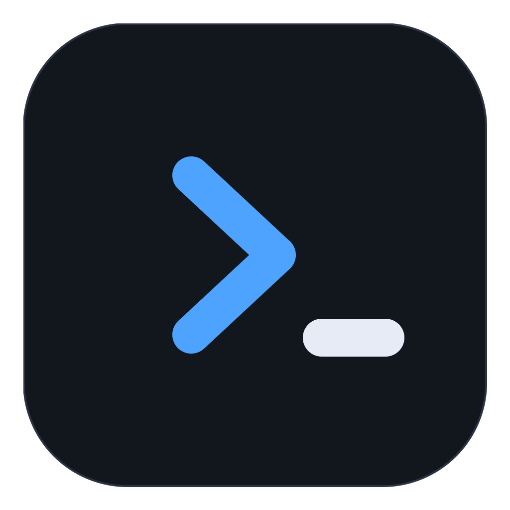
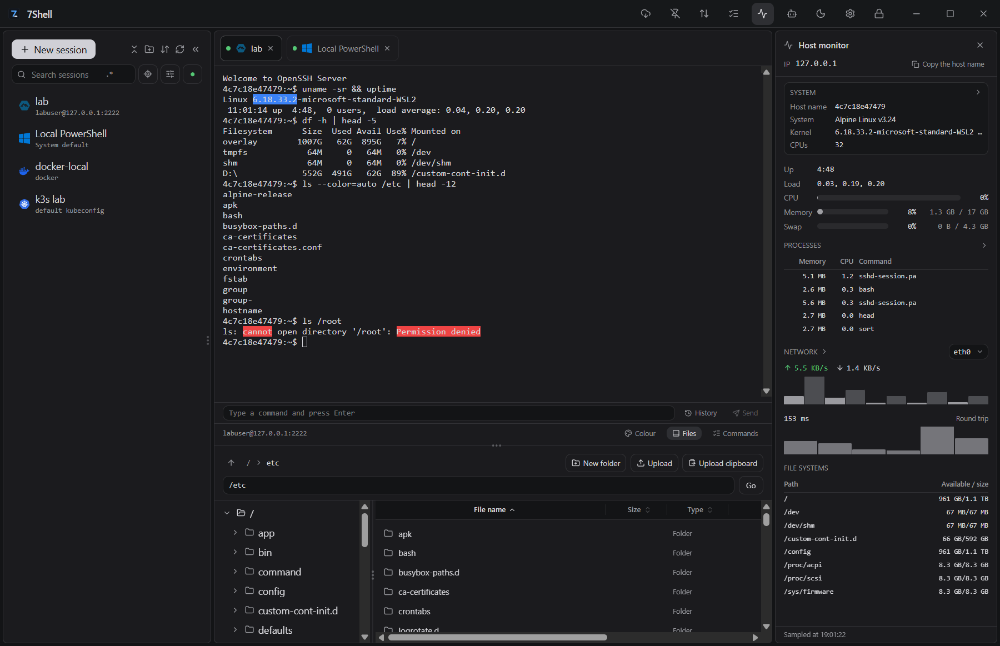
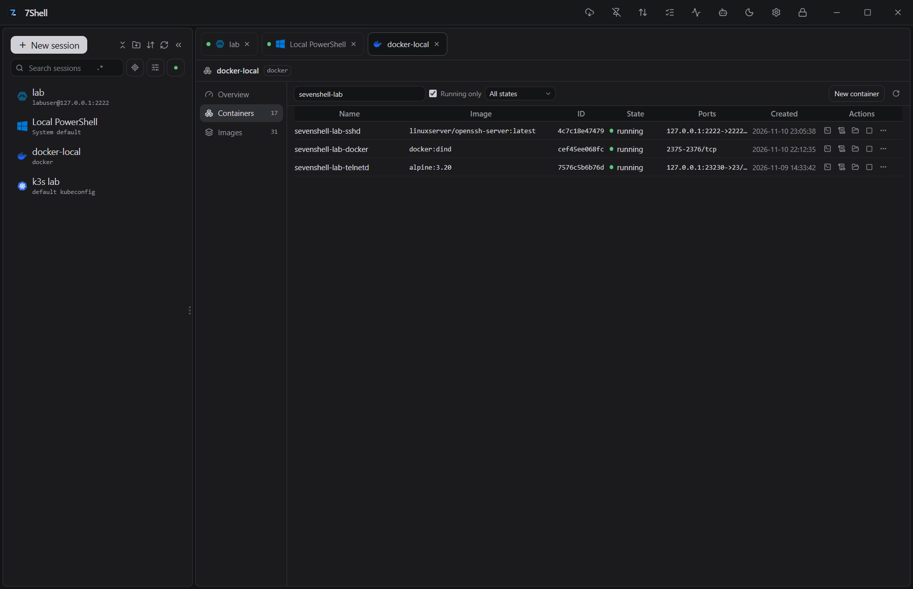
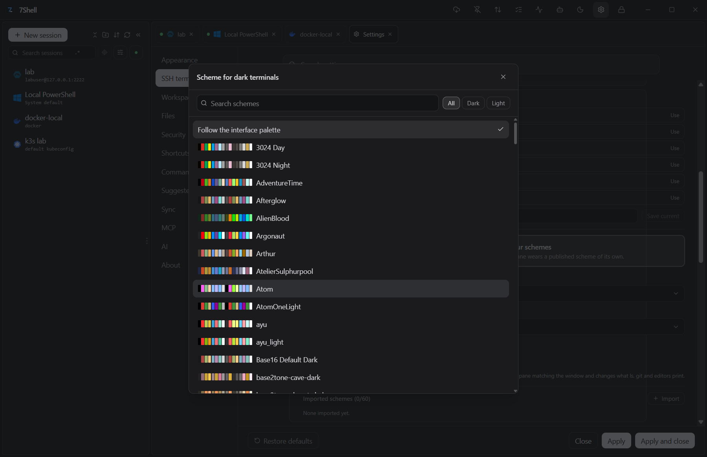
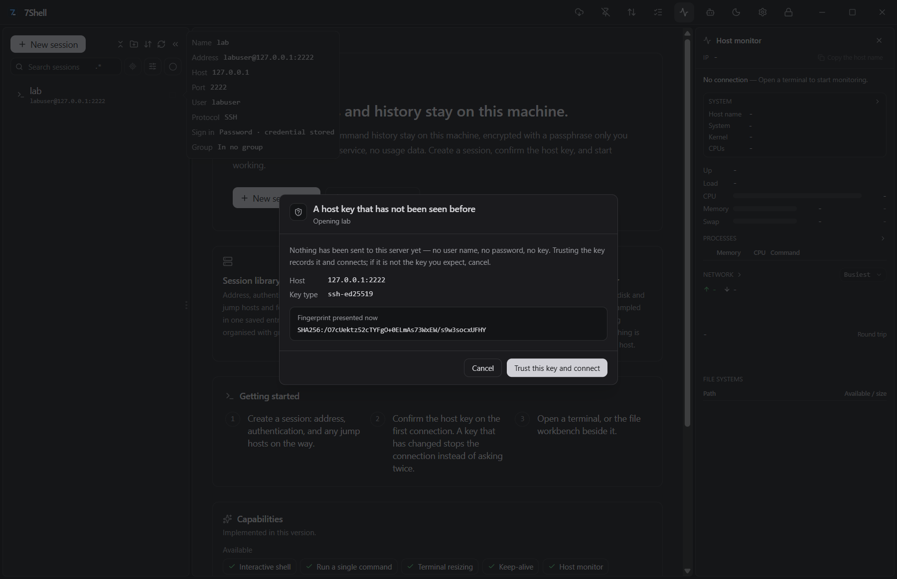

<div align="center">
  
  <h1>7Shell</h1>
  <p>开源的 SSH 运维客户端，支持 Windows、macOS 与 Linux<br>SSH、SFTP、Docker、Kubernetes、主机监控与批量执行</p>
  <p><a href="https://github.com/7wdn/7shell">GitHub</a> &nbsp;|&nbsp; <a href="docs/">文档</a> &nbsp;|&nbsp; <a href="https://github.com/7wdn/7shell/releases">下载</a></p>
</div>

<div align="center">
  <a href="README.md">English</a> &nbsp;|&nbsp; 简体中文
  <br><br>
  <a href="https://github.com/7wdn/7shell/releases"></a>
  <a href="https://github.com/7wdn/7shell"></a>
  <a href="LICENSE"></a>
</div>

## 目录

- [功能特性](#功能特性)
- [支持的连接](#支持的连接)
- [界面截图](#界面截图)
- [下载安装](#下载安装)
- [使用流程](#使用流程)
- [技术栈](#技术栈)
- [从源码构建](#从源码构建)
- [项目结构](#项目结构)
- [文档](#文档)
- [安全设计](#安全设计)
- [参与贡献](#参与贡献)
- [开源协议](#开源协议)

## 功能特性

### 终端

- **远程终端** — SSH（密码、私钥、键盘交互、系统密钥代理）、Telnet、原始 TCP、串口。
- **本地终端** — PowerShell、命令提示符、Git Bash、Unix 登录 Shell，以及 Windows 上的 WSL。
- **终端功能** — 多标签、搜索、链接、保活、断线重连、asciicast v2 会话录制。
- **外观** — 内置 190 款终端配色；字体、字号、行高、字距、光标样式可调；关键词高亮自带 22 条规则（ERROR、WARN、IP 地址等），可以增删。
- **跳板与转发** — 通过其他已保存会话连接；本地端口转发（`-L`）与 SOCKS5 代理（`-D`）。

### 文件

- **SFTP 工作台** — 双栏浏览，新建、改名、删除、直接编辑文本，上传和下载。
- **传输队列** — 暂停、续传，关闭标签后继续；SSH 下整个目录可以打成一个归档。
- **其他文件服务** — WebDAV、FTP/FTPS 目录开在同一个工作台里；没有 SFTP 的服务器降级到 SCP。
- **ZMODEM** — 终端里的 `rz`、`sz`，使用系统的文件选择和保存对话框。

### 容器与集群

- **容器** — Docker、Podman、nerdctl、WSLC：容器、镜像、日志、统计、exec 终端、文件和镜像归档导入；可以走本机，也可以走 SSH 会话。
- **Kubernetes** — kubeconfig 上下文、资源列表与 watch、Pod 日志、exec、Pod 文件、指标和 YAML 编辑；直连或经 SSH 会话。

### 运维

- **主机监控** — 负载、CPU、内存、交换区、磁盘、进程、网络和连接，走已经打开的连接采样，服务器端不用安装任何东西。
- **批量执行** — 一条命令发给多台主机，每台一份结果，运行前给出风险判定。
- **命令库** — 带 `#1`–`#5` 槽位的已保存命令、历史与补全，可以发给一个终端，也可以发给全部终端。
- **界面** — 跟随系统、深色或浅色主题；支持中文和英文。
- **同步** — 会话和命令同步到 WebDAV 服务器，或存成 GitHub、Gitee、GitLab 上的片段。
- **RDP** — Windows 桌面，交给系统远程桌面客户端打开。

### 助手与 MCP

- **助手** — 支持 Anthropic、OpenAI 兼容接口和本地模型。
- **MCP 服务端** — 外部 MCP 客户端可以在已保存的连接上调用同一套工具，凭据不出应用。
- **审批与审计** — 工具调用经过风险规则，需要时弹出审批，并写入审计日志。

## 支持的连接

| 类别 | 连接 | 说明 |
| --- | --- | --- |
| 终端 | SSH | 密码、私钥、键盘交互或系统密钥代理 |
| 终端 | Telnet | RFC 854 子集，包含嵌入式设备需要的 Enter 与 Backspace |
| 终端 | 原始 TCP | 纯 socket，逐字节收发 |
| 终端 | 串口 | 端口、波特率、数据位、校验位、停止位与流控 |
| 终端 | 本地 Shell | PowerShell、命令提示符、Git Bash、Unix 登录 Shell |
| 终端 | WSL | 已安装的发行版，仅 Windows |
| 文件 | SFTP | 浏览、编辑、上传和下载 |
| 文件 | SCP | 服务器没有 SFTP 子系统时降级使用 |
| 文件 | FTP / FTPS | 普通 FTP，或登录前建立 TLS |
| 文件 | WebDAV | HTTP 目录，在同一个工作台里 |
| 文件 | ZMODEM | 终端里的 `rz` 和 `sz` |
| 容器 | Docker | 容器、镜像、日志、统计、exec、文件 |
| 容器 | Podman | Podman 引擎，同样的工作区 |
| 容器 | nerdctl | containerd，可选 namespace |
| 容器 | WSLC | Windows 容器，仅 Windows |
| 集群 | Kubernetes | 上下文、资源、日志、exec、文件、指标、YAML |
| 远程桌面 | RDP | 仅 Windows，交给系统客户端 |

## 界面截图

<p align="center">
  
  
</p>
<p align="center">
  
  
</p>

## 下载安装

安装包发布在 [GitHub Releases](https://github.com/7wdn/7shell/releases)。

- **Windows** — `.exe`（NSIS）或 `.msi`，按用户安装，不需要管理员权限。
- **macOS** — Apple 芯片或 Intel 的 `.dmg`。
- **Linux** — `.AppImage`、`.deb` 或 `.rpm`。

安装包没有代码签名，macOS 版本也没有公证。Windows SmartScreen 和 macOS Gatekeeper 会提示未签名的应用，macOS 还可能拒绝第一次启动。运行前请核对发布说明里的 SHA-256。每个版本都附带 Winget、Scoop 和 Homebrew 清单，但目前还没有提交进各自的仓库。

## 使用流程

1. 首次启动时创建保险库。口令不会被保存，丢失后无法找回。
2. 新建连接，填写地址、认证方式，需要时加上跳板机。
3. 第一次连接时确认主机键。主机键发生变化会直接中断连接，不会再次询问。
4. 打开终端。下方的文件工作台和右侧的主机监控使用同一个会话。

## 技术栈

| 层级 | 技术 |
| --- | --- |
| 桌面外壳 | Tauri 2 |
| 内核 | Rust（russh、portable-pty） |
| 界面 | Vue 3、Pinia、Tailwind CSS |
| 终端 | xterm.js |
| 助手 | Anthropic Messages、OpenAI 兼容、本地模型 |

## 从源码构建

- Rust，版本由 `rust-toolchain.toml` 固定，`rustup` 会在第一次构建时安装。
- Node 22.13 或更新，以及 pnpm 11。
- Windows：MSVC 工具链和 WebView2。
- Linux：WebKitGTK 与 GTK 开发包。

```bash
git clone https://github.com/7wdn/7shell.git
cd 7shell
pnpm install
pnpm dev:tauri   # 桌面应用
pnpm check       # 全部门禁
```

完整的开发环境和测试命令见 [CONTRIBUTING.md](CONTRIBUTING.md)。

## 项目结构

```text
crates/          Rust 内核：SSH、SFTP、容器、Kubernetes、策略、AI、MCP
src-tauri/       Tauri 宿主：命令注册、窗口、原生对话框
apps/desktop/    Vue 3 界面
descriptors/     能力描述符，生成通信类型与 manifest
docs/            文档与截图
```

## 文档

- [安装](docs/guide/install.md)
- [快速开始](docs/guide/getting-started.md)
- [安全模型](docs/security-model.md)
- [架构](docs/architecture.md)
- [常见问题](docs/guide/faq.md)与[故障排查](docs/guide/troubleshooting.md)

## 安全设计

- 凭据保存在本机保险库里，用 Argon2id 和 XChaCha20-Poly1305 加密，口令不保存。
- 先用不发送任何内容的探测读取主机键，与本机已信任的键比对，通过后才用于认证。未知的键需要确认，发生变化的键会中断连接。
- 界面拿不到本地路径。文件在 Rust 侧的原生对话框里选择，交给界面的只是不透明令牌。
- 助手和 MCP 客户端的工具调用要经过风险规则和审计日志，需要时弹出审批。终端里的输入不拦截。
- 更新检查是应用唯一会自己发出的请求，可以关闭。同步只连接你配置的服务器。

每条安全不变量和对应的测试见[安全模型](docs/security-model.md)。

## 参与贡献

欢迎提交 Issue 和 Pull Request。[CONTRIBUTING.md](CONTRIBUTING.md) 里是开发环境、测试命令和改动要遵守的规则。漏洞请按 [SECURITY.md](SECURITY.md) 报告，不要开公开的 Issue。

## 开源协议

Apache-2.0，见 [LICENSE](LICENSE)。
